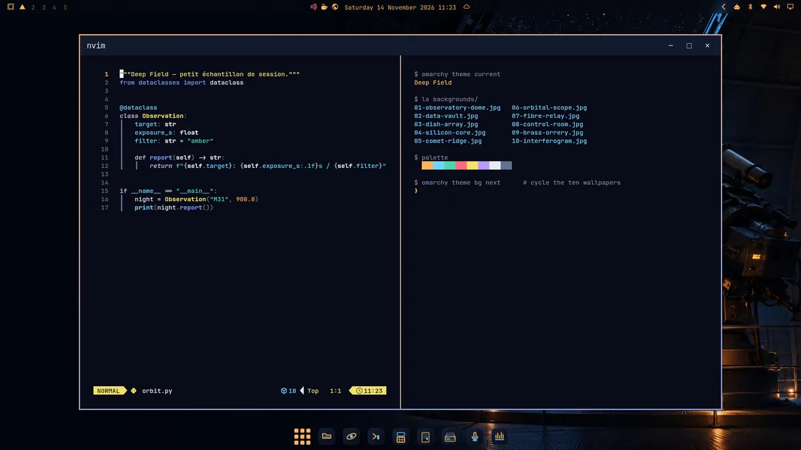
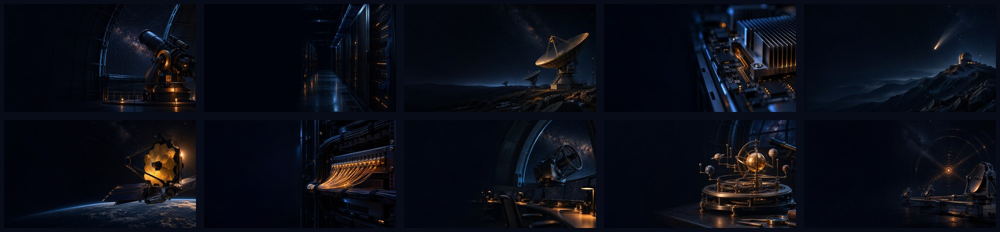
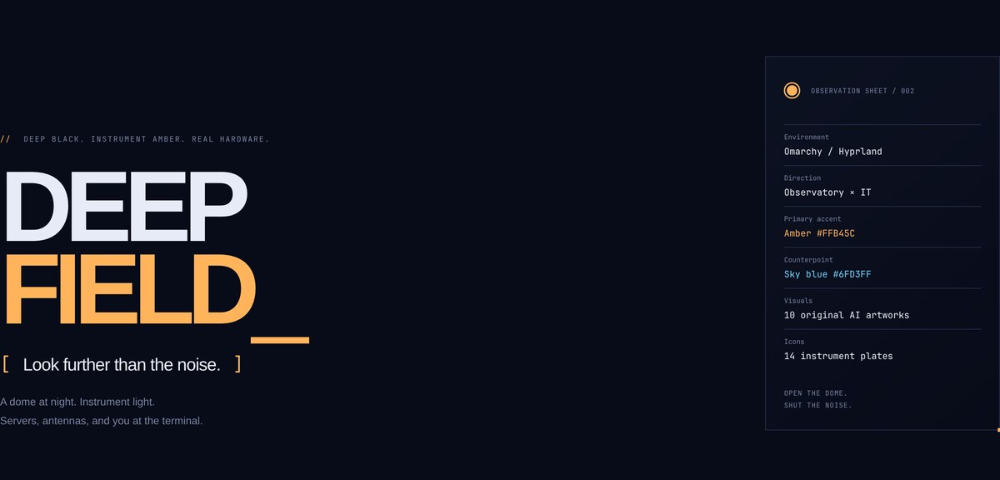
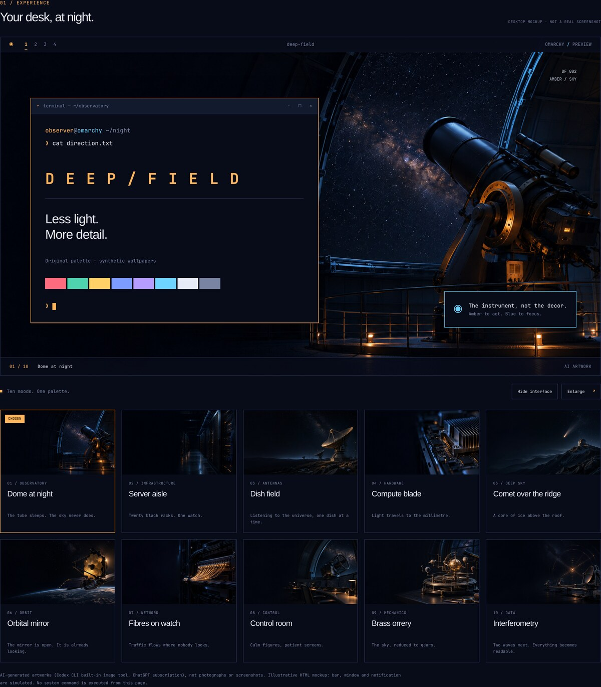
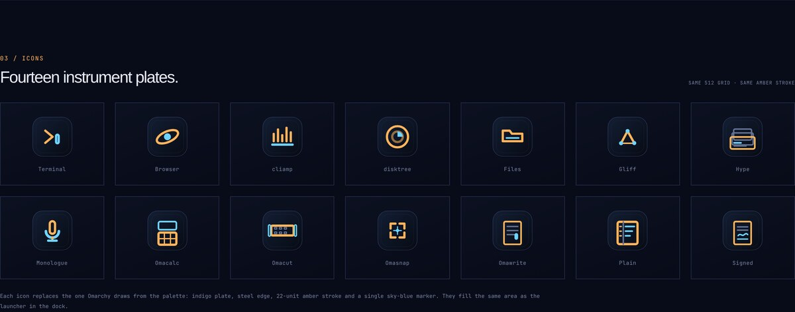
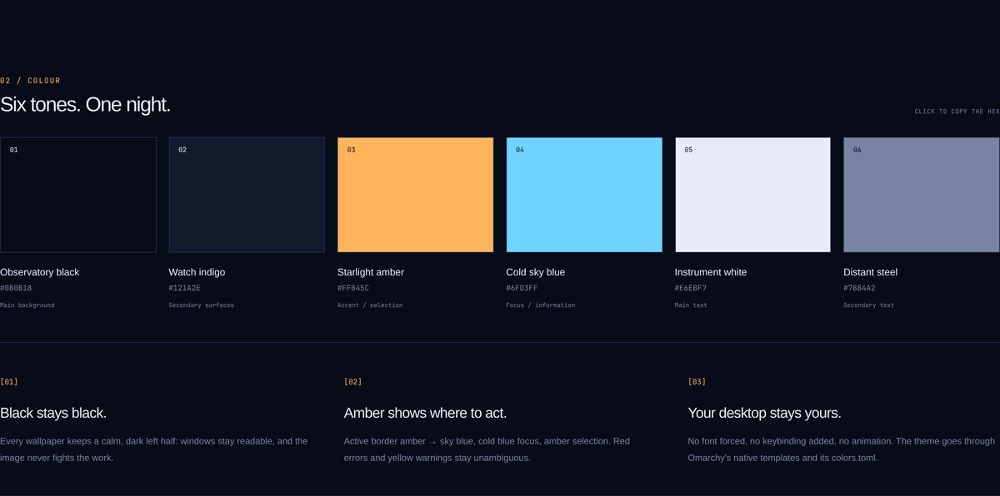

# Deep Field for Omarchy

A dark observatory theme: deep indigo-black surfaces, starlight amber as the single accent, cold sky
blue for focus, and ten original wallpapers that mix astronomical instruments with computer hardware.
Everything is generated from one `colors.toml`, so the terminal, btop, Chromium, Hyprland, Neovim,
Helix, the shell bar and the lock screen all follow the same palette.



## Install

```sh
omarchy theme install https://github.com/erfinfo/omarchy-deep-field-theme
omarchy theme set deep-field
```

Cycle the ten wallpapers with `omarchy theme bg next`.

## What is inside

| File | Purpose |
| --- | --- |
| `colors.toml` | Semantic palette, ANSI colours, Hyprland border gradient |
| `shell.bar.toml` | Bar text in amber, so the dock launcher follows the accent |
| `shell.controls.toml` | Cold blue focus, amber hover and selection |
| `icons/` | Fourteen application icons drawn for this theme |
| `icons.theme` | `Adwaita`, the GTK icon theme actually installed |
| `backgrounds/` | Ten wallpapers, 1664×936, exactly 16:9 |
| `preview.png`, `preview-unlock.png` | Theme picker thumbnail and illustrative unlock preview |
| `unlock.png` | Omarchy wordmark in amber, used by the boot decryption screen |

On install, Omarchy keeps every colour file and drops the ones that would run code (`*.lua`, terminal
configs, `vscode.json`). Deep Field ships none of those: it is colour, icons, wallpapers and the
preview page.

### The dock launcher

The first item of the dock is not an icon: Omarchy draws that 3×3 grid in QML with the bar's text
colour. `shell.bar.toml` therefore puts `[bar] text` on `#FFB45C`, which makes the launcher follow the
theme accent and, unavoidably, the rest of the bar amber too. Switch to another theme and the bar goes
back to its own colours.

## Wallpapers

Ten distinct scenes, each composed with the subject in the right third and a calm left half so that
windows stay readable.



| # | Name | Scene |
| --- | --- | --- |
| 01 | Dome at night | A telescope inside an open dome, Milky Way above |
| 02 | Server aisle | Cold aisle between black racks, sparse amber LEDs |
| 03 | Dish field | Radio telescopes on a plateau under a starry sky |
| 04 | Compute blade | Macro of a board and its machined heatsink |
| 05 | Comet over the ridge | A summit observatory under a comet |
| 06 | Orbital mirror | A space telescope above the Earth limb |
| 07 | Fibres on watch | A fibre patch panel glowing amber |
| 08 | Control room | A control desk under the dome |
| 09 | Brass orrery | A machined astronomical instrument |
| 10 | Interferometry | Amber measurement rings on near-black indigo |

## Icons

Fourteen icons replace the ones Omarchy draws from the palette: one indigo instrument plate, one steel
edge, a 22-unit amber stroke on a 512 grid, and a single sky-blue marker. They fill the same area as
the dock launcher at `iconSize = round(36 × fontScale)`.


## Palette

| Role | Hex | Use |
| --- | --- | --- |
| Observatory black | `#080B18` | Main background |
| Watch indigo | `#121A2E` | Secondary surfaces |
| Starlight amber | `#FFB45C` | Accent, active border, selection |
| Cold sky blue | `#6FD3FF` | Focus, information |
| Instrument white | `#E6EBF7` | Main text (16.4:1 on the background) |
| Distant steel | `#7884A2` | Secondary text (5.25:1) |

Errors use `#FF6B7E`, warnings `#F2E06A`, success `#4FD3AE`. Each one is separated in hue from the
amber accent so it reads as meaning, not decoration. The active window border is an amber → sky blue
gradient at 45°, the inactive border `rgba(3d4a6b aa)`.

## Preview page

`preview.html` is a self-contained page (no network dependency) that shows the theme, lets you switch
between the ten wallpapers, and copies palette hexes. Open it locally in any browser.






The desktop mockup is labelled as a mockup: it is HTML, not a screenshot, and it runs no system
command.

## About the wallpapers

The ten artworks are **AI-generated**, not photographs. They were produced with the built-in image
tool of the official Codex CLI, signed in with a ChatGPT subscription; no API key was used and no
third-party provider was involved. Prompts, native dimensions and SHA-256 hashes are in
[`docs/wallpapers.json`](docs/wallpapers.json); sources and disclosure are in
[`docs/references.md`](docs/references.md).

The exact image model identifier, the quota consumed and the marginal cost are **not exposed** by the
client, so they are not claimed here. Native output was 1672×941, centre-cropped to 1664×936 (16:9),
never upscaled.

## Compatibility

Built and tested on Omarchy 4.0.0 (Hyprland 0.57, Quickshell shell) in November 2026. Nothing outside
the theme folder is modified: no keybinding, no font, no animation, no file in `/usr/share/omarchy/`.

## Credits

Created by Erick Fortin ([EFC Informatique](https://efcinfo.com)). The palette, the fourteen icons and
the preview page are original work; the references behind the art direction are listed in
[`docs/references.md`](docs/references.md) and no third-party artwork was reused.

## License

Theme files, icons and preview page: MIT (see [LICENSE](LICENSE)).
Wallpapers: CC BY 4.0 — reuse them with attribution.
